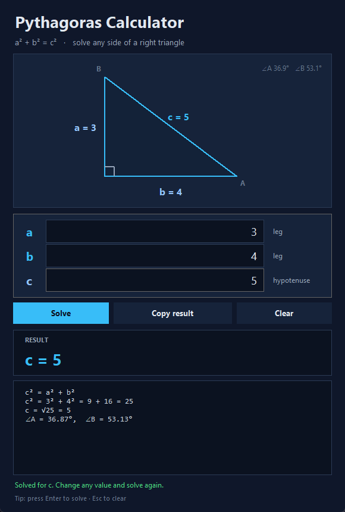

# Pythagoras Calculator

A small Windows desktop app that solves right triangles with **a² + b² = c²**.



## Use

Run **`Pythagoras Calculator.exe`** (single file, no install needed).

- Enter any **two** sides, leave the third empty, press **Solve** (or Enter).
- Enter all three sides and solve to check whether they form a right triangle.
- **Copy result** puts the answer and working on the clipboard. **Esc** clears.
- The picture and angle readout update with every answer.

Constraints: all sides must be positive, and the hypotenuse `c` must be the longest side.

## Files

- `pythagoras.py` – app source (standard library only, tkinter)
- `assets/pythagoras.ico` – app icon
- `make_icon.py` – regenerates the icon (needs Pillow)
- `version_info.txt` – Windows file-properties metadata
- `dist/` – build output; the portable exe is generated here and is not committed

## Rebuild

```powershell
py -3.14 -m pip install pyinstaller pillow
py -3.14 make_icon.py
py -3.14 -m PyInstaller --noconfirm --clean --onefile --windowed `
  --name "Pythagoras Calculator" --icon "assets\pythagoras.ico" `
  --add-data "assets\pythagoras.ico;assets" --version-file "version_info.txt" `
  pythagoras.py
```

The result lands in `dist/`. It is a 64-bit portable app for Windows 10/11.
